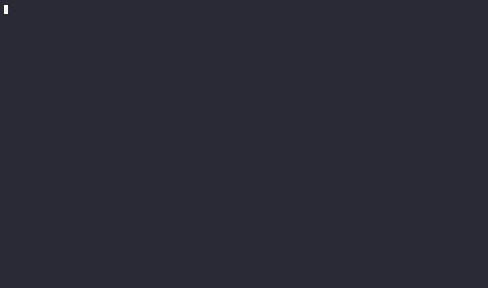

# agents-farm

A terminal dashboard for your [Claude Code](https://claude.com/claude-code) agents.
See which agents are working, what they do, how full their context is, and how much of your limits you have used.



> Try it without any real sessions: `af --demo` (see [Install](#install))

## Features

- **Live agent list.** Every session has a status symbol and a colour. Agents that wait for you (`?`) or have an error (`!`) are always on top. Subagents show under their parent (`└`).
- **Details you can open.** Context (prompt, files, tokens), Activity (every step with time) and Plan (from TodoWrite or `update_plan`). Press `enter` for a full-screen view.
- **Limits and context bars.** Usage per model in the current window, with warning colours and a reset timer.
- **Alerts.** A notification and a bell when an agent starts to wait for you, fails, or a limit goes above 90%.
- **Process info.** A PID column shows the process of each running session. The details also say if it runs in Claude Desktop or in the CLI.
- **Fuzzy search.** Type a few letters (`apirf` finds `api-refactor`). You can add filters: `status:waiting`, `model:opus`, `project:api`.
- **Terminal friendly.** Works on narrow screens, and has a one-line mode for tmux and status lines.

## Install

You need Python 3.9 or newer and Claude Code. It works on macOS and Linux.

```bash
git clone https://github.com/mythes/agents-farm.git
cd agents-farm
scripts/install.sh
```

The script makes a private virtual environment in `~/.local/share/agents-farm` and adds two commands to `~/.local/bin`: `agents-farm` and the short name **`af`**. Then run `af --demo`.

If `~/.local/bin` is not on your `PATH`, the script prints the line to add to your shell config.

**It never overwrites anything it did not create.** Before it makes `af`, it checks that the name is free: no other program on your `PATH`, no alias or function in your shell config. If the name is taken, it skips the short name, tells you why, and installs `agents-farm` anyway. Pick another name with `--name`:

```bash
scripts/install.sh --name farm        # use another short name
scripts/install.sh --no-alias         # only `agents-farm`
scripts/install.sh --dry-run          # show the plan and the checks, change nothing
scripts/install.sh --uninstall        # remove the commands and the virtual environment
```

The script does not edit your shell config or `~/.claude/settings.json`. `--uninstall` removes only what the script created, and keeps your data in `~/.agents-farm`.

Install without a clone (read the script first: [scripts/install.sh](scripts/install.sh)):

```bash
curl -fsSL https://raw.githubusercontent.com/mythes/agents-farm/main/scripts/install.sh | bash -s -- --ref v0.2.0
```

> **Why `af`?** It is short, and at the time of writing it is free in Homebrew, PyPI and Debian. Two old tools use the same name: an npm package (the AppFog CLI) and a Rust crate (an HTTP fetch tool). If you installed one of them, or you have `alias af=…`, the script will notice and keep your command. The short name is only a link made on your machine, so the package itself does not claim `af` for everyone.

For development, install in editable mode: `scripts/install.sh --editable`, or use a virtual environment with `pip install -e '.[dev]'`.

## Use

After the install, `af` and `agents-farm` are the same command.

```bash
agents-farm             # your real sessions from ~/.claude/projects
agents-farm --demo      # fake data, good for a first look
agents-farm --since 24  # show sessions from the last 24 hours (default: 12)
```

One-line status (for tmux or a status line) and JSON (for scripts):

```bash
agents-farm status          # ?1 ●2 │ sonnet 25% │ opus 7%
agents-farm status --json
```

## Keys

| Key | Action |
|---|---|
| `↑` `↓` / `j` `k` | Move between agents |
| `enter` / `z` | Zoom: details on the full screen. `esc` goes back |
| `1` `2` `3` | Open or close Context / Activity / Plan |
| `e` | Open or close all sections |
| `/` | Search: a few letters (`apirf` finds `api-refactor`) and filters (`status:waiting`, `model:opus`, `project:api`) |
| `h` | Show or hide idle sessions and finished subagents |
| `y` | Copy `cd … && claude --resume <id>` (works over SSH too) |
| `p` | Copy the PID of the agent's process |
| `x` | Stop the agent's process. It asks first, and the default answer is No |
| `n` | Start a new `claude` session in this terminal: folder browser, model list, permission mode, worktree |
| `o` | Open the full log in `$PAGER` |
| `?` | Help |
| `q` | Quit |

## Starting a new session

Press `n`. The dialog is a small folder browser:

- The path field starts with the folder of the selected agent. The list under it shows the sub-folders of that folder, with `use this folder` and `..` on top. A panel on the right previews the marked folder: its content, the git branch, and how many Claude sessions you had there.
- Delete back to a `/` and you see the neighbouring folders. Type letters after the last `/` and the list is filtered with fuzzy matching (`apirf` finds `api-refactor`, the matched letters are highlighted).
- With no `/` in the field (or an empty field) the list shows your recent projects, newest first.
- `↑` `↓` move in the list while you type. `Tab` (or `→` at the end of the text) opens the marked folder. `Enter` starts `claude` there (on the `..` row, `Enter` goes up instead).
- `Ctrl+A`, `Ctrl+S` and `Ctrl+D` are next to each other on the left hand, so the dialog can be driven with one hand. `Ctrl+A` picks the model from a short fuzzy list: `default`, the aliases (`fable`, `opus`, `sonnet`, `haiku`: always the latest version), the models found in your sessions, and the names in `models` in the config. A name that is not in the list can be typed and used as it is. `Ctrl+S` changes the permission mode (`default`, `acceptEdits`, `plan`). `Ctrl+D` turns the git worktree (`-w`) on or off. The line above the footer shows the current choices, and the next dialog starts with them.

`claude` starts in this same terminal and agents-farm steps aside. When you leave `claude` (`/exit`), the dashboard comes back and selects the new session.

- Modes that skip permission checks are not offered. You can still pass any flag yourself with `claude_args` in the config.
- `claude` is looked up on `PATH`, then in `~/.local/bin`. Set `claude_bin` in the config to use another program.
- The list only reads folder names (not recursive, at most 500 per folder, hidden folders only when you type a dot).
- In `--demo` mode nothing is started.

## Stopping an agent

Select an agent and press `x`. A dialog shows the name, the PID, and what will happen. Only `y` confirms: `n`, `Esc` and `Enter` all cancel. Then agents-farm sends `SIGTERM` (a normal stop). If the process is still running after 3 seconds, it asks again before it sends `SIGKILL`.

- **Claude Desktop.** Desktop starts a new process for the chat when you send the next message, and the history is kept. If the agent is working (`busy`) or waits for you, the current turn or the question is lost, and the dialog says so in red.
- **CLI.** The claude session in its terminal ends. The dialog shows the `claude --resume <id>` command to continue it.
- **Subagents** have no process of their own: select the parent session. Sessions that are not running cannot be stopped.

Before every signal the process is checked again, and the stop is **refused** if the PID now belongs to another program (a reused PID), to another user, or to a process that is not `claude` (for example the Desktop wrapper). It is also refused for agents-farm itself and its parent processes, so it can never close your own terminal. Every attempt, also a refused one, is written to `~/.agents-farm/actions.log` (readable only by you). In `--demo` mode no signal is ever sent.

To turn the key off, set `"allow_kill": false` in the config.

## Where the data comes from

1. **Transcripts** in `~/.claude/projects/**/*.jsonl`. They are read step by step (only new lines). They give the prompt, the steps, files, plan, tokens, model and context size.
2. **Process files** in `~/.claude/sessions/<pid>.json`, written by Claude Code. They give the PID, Desktop or CLI, and the version. A PID is shown only if that process is running and its start time matches the file, so a reused PID is never shown for the wrong session. Their `status` field (`idle`, `busy`, `waiting`) is also the **live status** of the agent: the exact `? waiting` needs no setup, and it appears about 6 seconds sooner than the Claude Code notification hook.
3. **Hooks** (optional). The status no longer depends on them. When hooks are installed, they add the text of the request (for example `permission: Bash`), and they are the only source for sessions that have no process file (older Claude Code versions). Without a process file and without hooks, "waiting for permission" can only be guessed, and the agent can show as `⏸ stalled`.

### Install the hooks (optional)

Print the block for your `~/.claude/settings.json`:

```bash
agents-farm hooks-snippet
```

Add the content of `"hooks"` to your settings. If you already have hooks for the same events, put the new entries next to the old ones. The hook writes one line to `~/.agents-farm/events.jsonl` (about 140 ms per call). It never fails and always exits with code 0. The top bar tells you where the status comes from: `live ✓` (process files), `hooks ✓`, or both.

## Limits: please read

Claude Code does not save your remaining plan quota on disk. For now the limit bars are an **estimate**: the sum of tokens (input + output + cache write) per model in the current 5-hour window, compared with a budget from the config.

The default budgets are **placeholders**. Set numbers that match your plan in `~/.agents-farm/config.json`. A value of `0` means "unknown": only tokens are shown.

Real plans use one 5-hour window and one weekly window, not a budget per model. Official numbers (from the Claude Code `statusLine` data) are planned: see [issue #11](https://github.com/mythes/agents-farm/issues/11).

## Config

All keys are optional. The file is `~/.agents-farm/config.json`:

```json
{
  "limits": {"opus": 4000000, "sonnet": 8000000, "haiku": 20000000},
  "window_hours": 5,
  "count_cache_read": false,
  "warn": 0.7,
  "crit": 0.9,
  "since_hours": 12,
  "notify": true,
  "busy_stalled_s": 600,
  "allow_kill": true,
  "claude_bin": "",
  "claude_args": [],
  "claude_env": {},
  "new_model": "",
  "models": [],
  "context_window": {"default": 200000, "opus-5": 1000000, "sonnet-5": 1000000}
}
```

`claude_args` are extra flags for every new session (a list of strings), `claude_env` are extra environment variables, and `new_model` is the default model in the dialog. `models` adds model names to its list.

`busy_stalled_s` is how long a `busy` agent may print nothing before it is shown as stalled (default 10 minutes).

`context_window` sets the context size by a part of the model id (the longest match wins). Transcripts do not store this size, so check the number with `/context` in Claude Code and change it here if needed. If a session goes over its window, the window grows by itself, so the bar never shows more than 100%.

## Security and tests

Text from transcripts and hooks is treated as untrusted input (prompt injection). See [SECURITY.md](SECURITY.md).

```bash
.venv/bin/pip install -e '.[dev]'
.venv/bin/pytest
.venv/bin/bandit -r agents_farm
```

## Project layout

```
agents_farm/
  transcripts.py  incremental parser for JSONL transcripts
  tail.py         reads files in chunks
  registry.py     running processes from ~/.claude/sessions (PID, Desktop or CLI)
  killer.py       safe stop of a process (checks before every signal)
  search.py       fuzzy search and filters
  events.py       hook handler and reader for events.jsonl
  store.py        builds a Snapshot and works out the statuses
  limits.py       usage per model in the 5-hour window
  render.py       Rich rendering of rows, details, limits (no Textual)
  app.py          Textual UI
  demo.py         fake data
  config.py       settings from the config file
  cli.py          command line
docs/             design notes and backlog
scripts/          checks and demo recording
.claude/skills/   skills for coding agents that maintain this repo
```

## Roadmap

See [docs/backlog.md](docs/backlog.md) and the [issues](https://github.com/mythes/agents-farm/issues). Done in v0.2.0: PID column, live status, fuzzy search, stop with `x`, start a new session with `n`. Next: resume a session, then real limits and the share of the limits per session.

## Contributing

Run `scripts/check.sh` before every commit. If you use Claude Code, the skills in `.claude/skills/` and the rules in [CLAUDE.md](CLAUDE.md) help you keep the repo in good shape.

## License

[MIT](LICENSE)
